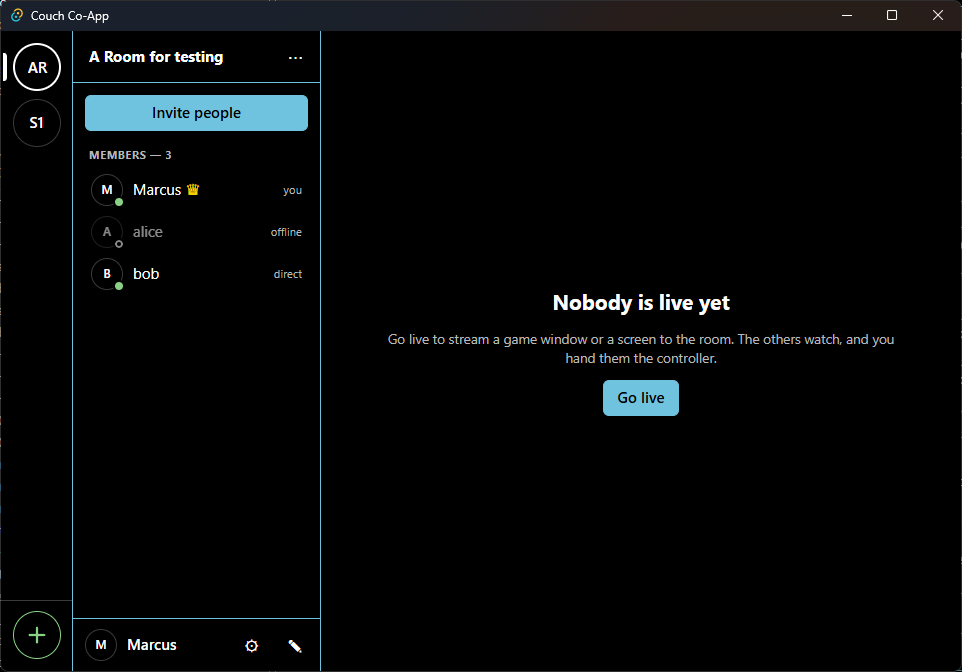
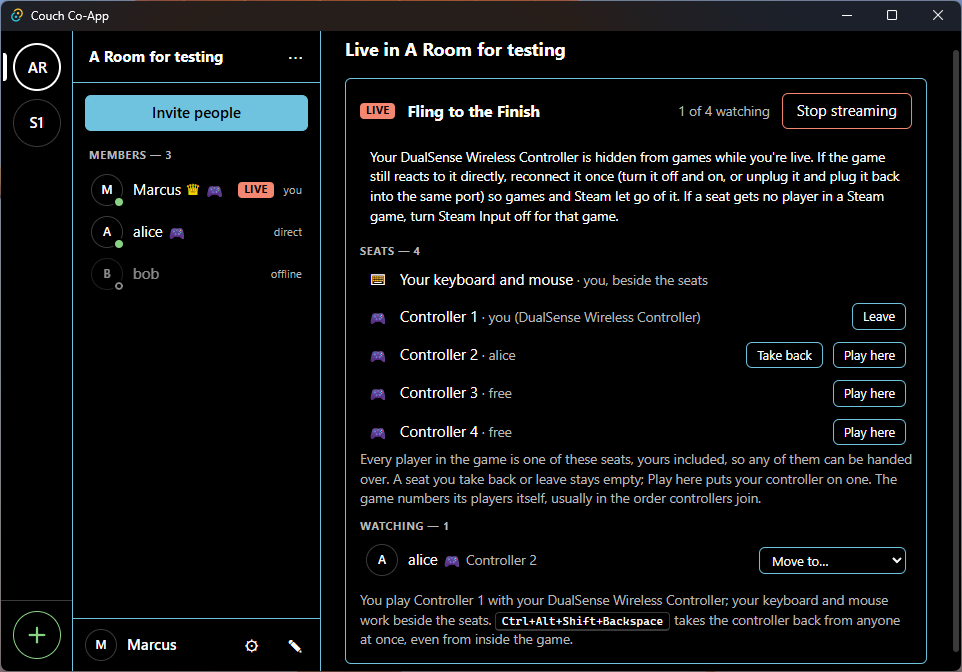
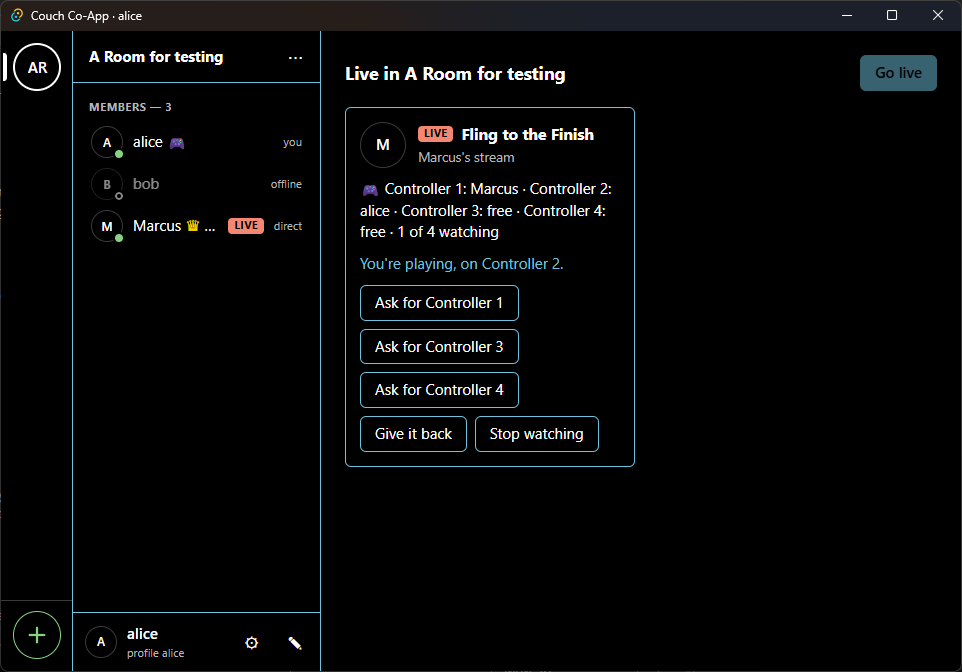
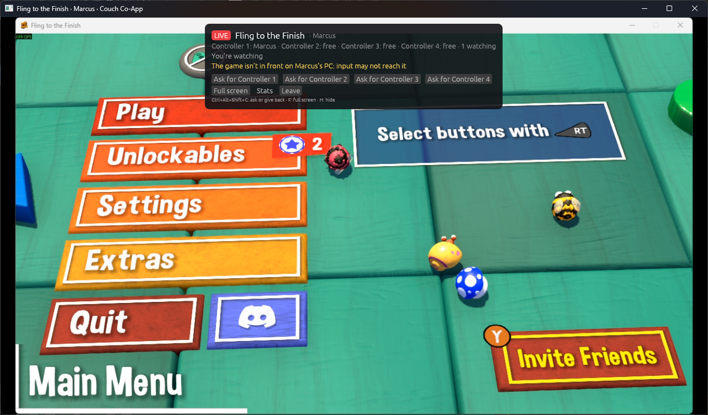

<h1 align="center">Couch Co-App</h1>

### What is it?

This is an app to emulate the feeling of "same couch" gaming, just like we used to do in the past, but remotely. Create a password-protected room, invite friends with a link, stream your game to them, and pass them the controllers.

### Why?

I miss the times when we sat on a couch and played games with our friends (especially single-player games, where we could pass the controller when we died or whatever).

### How?

This is a little experiment of mine to see how far we can go by just "vibecoding" something non-trivial (maybe I'm late to this party, but yeah). So for this project, I purposely turned on Claude's "auto mode" and never looked at any code. It wrote the code, ran builds and tests, and committed the work, while I described features and tried things out.

If you are curious, Claude did [document the journey](docs/architecture.md#status).

### About trust and safety

By "Going live", you can let others in the room control your PC's controllers, and possibly keyboard and mouse. You should only use it with people you trust!

### A note on contributing

I believe no one wants to contribute to a "vibecoded" repository, but feel free to send issues with bug reports, games that worked or didn't, or ideas.

> **FINAL DISCLAIMER: THIS IS WHERE WE END THE HUMAN-MADE SECTION OF THE REPO AND CLAUDE TAKES OVER (AT LEAST FOR NOW).**

---

**Status:** in development, Windows only for now.

<table align="center">
  <tr>
    <td align="center">
      
       
      <em>A room, with its members and how each is connected</em>
    </td>
    <td align="center">
      
       
      <em>Going live: the game, its controller seats, who's watching</em>
    </td>
  </tr>
  <tr>
    <td align="center">
      
       
      <em>A friend's app: they play Controller 2</em>
    </td>
    <td align="center">
      
       
      <em>Their stream window, showing the host's game</em>
    </td>
  </tr>
</table>

## Using it, building it, reading it

- **[Use it with your friends](docs/self-hosting.md):** there are no official downloads. Build your own installer and run your own small relay server, step by step.
- **[Develop it](docs/development.md):** set up a PC to build, run and test the app.
- **[How it works](docs/architecture.md):** the design and the milestones, with the [wire protocol](docs/protocol.md) and the [decisions behind it](docs/adr/).

## How it connects

Each pair of players' PCs talks directly over iroh (QUIC) whenever it can. A relay, a small server you run yourself, starts each connection and carries it when no direct path exists. Even then it only forwards encrypted traffic it can't read: rooms, passwords, video, sound and input stay between the players' PCs.

## Licence

Couch Co-App is free software under the **GNU General Public License, version 3** (GPL-3.0-only): see [LICENSE](LICENSE). You may use, study, share and change it. If you distribute a modified version, it must stay under the same licence, with its source available.

Bundled components keep their own licences:
- FFmpeg: LGPL v3, dynamically linked;
- SDL3: zlib;
- ViGEmBus: BSD-3-Clause;
- HidHide: MIT;
- the Rust crates and the front end's packages: mostly MIT and Apache-2.0, checked by `cargo deny`.

`cargo xtask notices` gathers them all into `THIRD-PARTY-NOTICES.txt`. Every installer carries it, and the app shows it in Settings → About.
