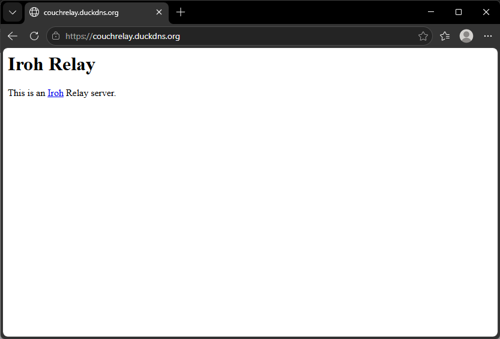
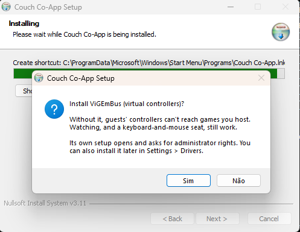
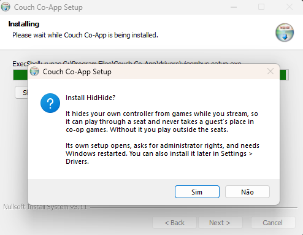
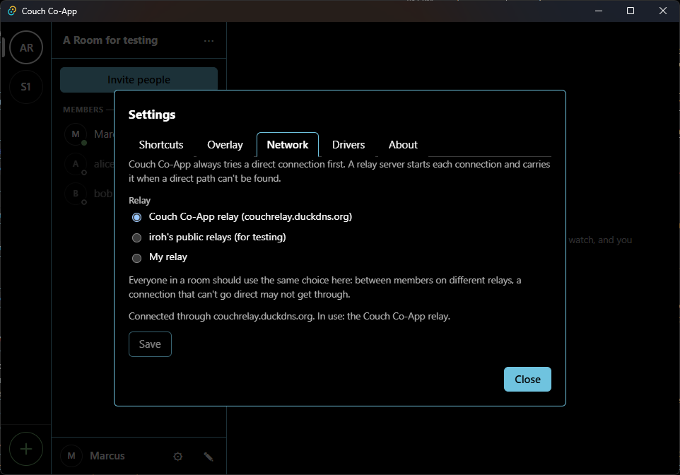
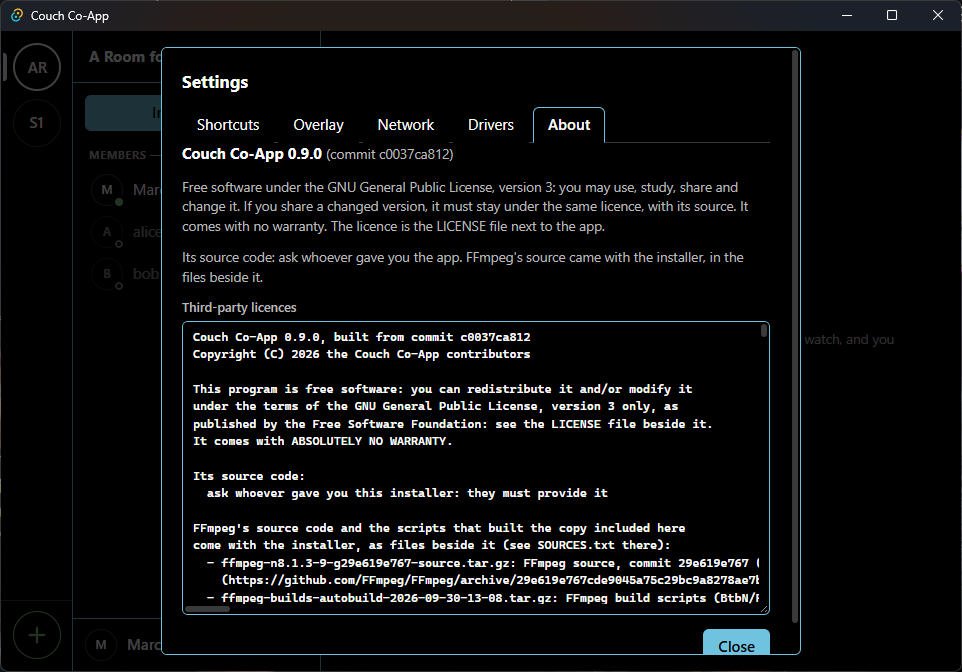

# Use it with your friends: your installer and your own relay

There are no official downloads ([ADR 0009](adr/0009-source-only-releases.md)). To play with your friends, you build the installer yourself, and run a small relay server that helps your friends' PCs find each other. This is the shortest path. It takes an afternoon the first time, mostly waiting for builds, and needs a Windows PC and a small Linux server.

## What you'll end up with

- **An installer** (`Couch-Co-App_<version>_<commit>-setup.exe`) that your friends run. It's unsigned, so Windows SmartScreen warns once: "More info", then "Run anyway".
- **A relay** on a server you control, which only your installers can use. The app connects your friends' PCs directly when it can, and through your relay when it can't.
- **If you like, an AppImage** (`Couch-Co-App_<version>_<commit>.AppImage`) for friends on Linux or a Steam Deck, who watch and play sessions, and on a Linux desktop host them too, with controller seats ([step 4](#4-an-appimage-for-friends-on-linux)).

## 1. Prepare your Windows PC (once)

1. **Install:**
   - Git;
   - Visual Studio Build Tools, with the **Desktop development with C++** workload;
   - Rust (`winget install --id Rustlang.Rustup -e`);
   - Node.js;
   - CMake (`winget install Kitware.CMake`).
2. **Two cargo tools,** in a new terminal:
   ```powershell
   cargo install cargo-deny --locked
   cargo install --locked cargo-about --features cli
   ```
3. **Get the code,** to a short path:
   ```powershell
   git clone <this repository's address> C:\dev\couch-coapp
   cd C:\dev\couch-coapp
   ```
4. **Fetch the dependencies.** In PowerShell, from that folder (run the first line in every new terminal):
   ```powershell
   . .\scripts\dev.ps1
   cargo xtask fetch-deps
   cargo xtask stage-dlls
   cd apps\desktop; npm install; cd ..\..
   ```
5. **Create your private settings and token:**
   ```powershell
   cargo xtask release-config
   ```
   It writes `%USERPROFILE%\.couch-coapp\release.toml` and prints a token. Keep the token in a password manager: the server needs it in step 2. The file is outside the code folder on purpose, so it never ends up in git.

## Do you need your own relay?

**iroh, the networking library the app uses, runs free public relays.** The app can use them, and needs no server of yours.

We still recommend your own, for regular play:
- **iroh offers its public relays for testing and hobby use,** with limits it doesn't publish and no promise they stay up;
- **with your own,** only your installers can use it, and it keeps working as long as you keep it running.

**To use iroh's public relays instead:** skip step 2, and build with `.\scripts\build-installer.ps1 -TestRelay` in step 3 (no `relay_url` needed). Those installers use iroh's public relays while no relay is added, and their names end in `-test`.

**Relays in the app** (Settings → Network, since 0.35.0):
- **A profile holds several relays at once,** each with its own code, and they all apply at once, no restart. Whoever runs a relay gives its **relay code** (one line); you paste it under Add a relay, and the app connects with it before saving. A relay open to everyone is added by its address.
- **Share its code** (in a relay's ⋯ menu) copies the code for a friend, kept out of the clipboard's history. Your own relay's code can also be made on the server ([deploy/relay/README.md](../deploy/relay/README.md#relay-codes)).
- **The public relays** are used while a profile has no relay of its own, and can be kept on beside yours, or let stand in when none of yours answers.
- **A friend reaches you through your relay only with its code,** or a build carrying it: your relay accepts only clients with its token. When two PCs can't connect directly, either holding the other's relay is enough.

## 2. Set up your relay (once)

You need a small Linux server (Ubuntu 24.04) with a name pointing at it. A free one works: [deploy/relay/README.md](../deploy/relay/README.md) walks through Oracle Cloud's free tier and a free DuckDNS name, step by step.

1. **Create the server and its name.** In the provider's firewall, open TCP 80, TCP 443 and UDP 7842.
2. **Copy the relay kit to it and install it.** From your PC, in the code folder:
   ```powershell
   scp -i <your SSH key> -r deploy/relay <user>@<your relay's name>:
   ```
   Then, on the server:
   ```bash
   cd relay && chmod +x install.sh
   sudo ./install.sh <your relay's name> <an email for Let's Encrypt>
   ```
   Paste your token when it asks. The first build can take a while on a small server.
3. **Check it:** open `https://<your relay's name>/` in a browser. You should see iroh-relay's page, with no certificate warning:

   

## 3. Build the installer (each time you hand one out)

1. **Point the build at your relay:** in `%USERPROFILE%\.couch-coapp\release.toml`, set
   ```toml
   relay_url = "https://<your relay's name>"
   ```
2. **Build**, in a terminal where you ran `. .\scripts\dev.ps1`:
   ```powershell
   .\scripts\build-installer.ps1
   ```
   It takes several minutes the first time. It needs the code exactly as committed: if you changed anything, commit it first (see [If you change the code](#if-you-change-the-code)).
3. **Hand out everything in `target\installer\`:**
   - the setup file;
   - FFmpeg's two source archives;
   - `SOURCES.txt`.

   The licences require that whoever gets the app can also get its source and FFmpeg's. To serve the folder on your network: `npx --yes http-server target\installer -p 8000`.

**What your friends will see when installing:** after the app installs, it offers the two drivers, one question each, with the buttons in Windows' own language:
- **ViGEmBus:** say yes if they'll host games, so guests' controllers reach the game;
- **HidHide:** optional. It lets the host's own controllers play through seats, one seat each.

Each one opens its own setup, and Windows asks for administrator rights. A driver already installed isn't offered again.

The first session someone hosts on a PC can take a while to get its controllers ready: Windows sets up each virtual controller the first time it's plugged in. The app says so, with a timer and a Stop waiting button; the controllers come up by themselves, and later sessions start at once.

| ViGEmBus | HidHide |
|---|---|
|  |  |

## 4. An AppImage for friends on Linux

Optional. A Linux PC or a Steam Deck **watches and plays** sessions, and runs a PC of yours from afar (remote play). A Linux PC on KDE or GNOME, in a Wayland session (the default on both), also **hosts**: guests' controllers need Settings → Drivers → Virtual controllers set up once, and the desktop asks which window or screen to share. Guests can have keyboard and mouse too, on KDE as it is (Plasma 6; Plasma 5.27, Kubuntu 24.04's, hasn't been tried), and on GNOME 46 or later once Settings → Drivers has installed our small extension (then log out and back in once): it tells the app which window is in front. When a stream starts, the app asks you which window is the game (it offers the likely one); a guest's keys reach that window only while it's in front, and their pointer stays inside it. It can also be the PC you run from afar (Settings → Remote play): share a screen at it once and let the desktop remember the choice, since nobody is there to answer the dialog later. Run from afar, your device can also control its desktop (a session with the keyboard seat), once Virtual controllers is set up there: the same setting gives it a virtual keyboard and mouse. The AppImage uses the system's own PipeWire library (`libpipewire-0.3`, which current desktops all have), even only to watch. One file, the AppImage, carries WebKitGTK and GTK with it, and runs on a system whose glibc is 2.39 or newer (`ldd --version` says): Ubuntu 24.04 and Fedora 40 are. A Steam Deck is: in Desktop Mode it watches and plays (tried 2026-11-09), but can't host, since Desktop Mode runs X11, where the desktop won't share its screen.

**Build it on Ubuntu 24.04.** WSL on your Windows PC works: `wsl --install -d Ubuntu-24.04`, then everything below inside it.
1. **Prepare it, once:**
   - **a clone of the code, on Linux's own disk** (in WSL never under `/mnt/c`): `git clone <this repository's address> ~/couch-release`, then `cd ~/couch-release`;
   - the system packages: `sudo bash scripts/linux-deps.sh`;
   - Rust (`curl --proto '=https' --tlsv1.2 -sSf https://sh.rustup.rs | sh`), Node.js 24 (from NodeSource: Ubuntu's own is too old), and `cargo install --locked cargo-about --features cli`;
   - the front end's packages: `cd apps/desktop && npm ci && cd ../..` (`npm ci` leaves the tree clean, which a release build needs).
2. **Your release settings:** the same `release.toml` as on Windows. On Ubuntu put it at `~/.couch-coapp/release.toml`; in WSL, point at Windows' own instead of copying it:
   ```bash
   export COUCH_RELEASE_CONFIG=/mnt/c/Users/<you>/.couch-coapp/release.toml
   ```
3. **Build**, from the clone, at the same commit as your Windows installer (`git pull`):
   ```bash
   bash scripts/build-appimage.sh
   ```
   It takes the same options as `build-installer.ps1`, spelled the Linux way: `--test-relay`, `--config <file>`, `--invite-page <address>`, `--no-invite-page`. The first build takes a while.
4. **Hand out everything in `target/appimage/`:** the AppImage, `THIRD-PARTY-NOTICES.txt`, FFmpeg's two source archives and `SOURCES.txt`. The notices also name the source of every system library the AppImage carries, as the licences ask.

**What your friends do with it:**
- **Make it executable,** then open it: in the file manager, Properties → "Executable as program" (or `chmod +x Couch-Co-App_*.AppImage`).
- **It needs FUSE,** which desktops normally have. Without it, start it with `--appimage-extract-and-run`.
- **On a Steam Deck:** in Desktop Mode, download it, make it executable, and open it. For Game Mode, add it to Steam as a non-Steam game.
- **Invite links** open it once it has started once. Moved to another folder, it needs one start there.
- **It adds itself to the app menu** when it starts (`~/.local/share/applications/com.couchcoapp.CouchCoApp.desktop`, and its icon in `~/.local/share/icons`): the desktop's shortcuts for the panic key need it. A newer AppImage takes the entry over once the old file is gone; deleting both files removes it.
- **Its data and log** are in `~/.local/share/CouchCoApp/profiles/default/` (`desktop.log`).

## How to know it worked

- **Settings → Network** lists your relay, marked "this app's", with "Connected: others reach you through it".
- **Settings → About** shows the version and the commit it was built from.

| Settings → Network | Settings → About |
|---|---|
|  |  |
- **Your friends can join your room** from an invite link and the password, from their own networks.

Everyone in a room needs an installer from the same build of yours. A different build shows "Needs update" in the member list. Other people's builds can't use your relay, because they don't have your token, unless you give them its code.

## What you can skip

- **The drivers on your build PC.** The installer offers them to whoever installs it.
- **The invite page,** an optional page that makes invite links clickable in chat apps. To use it, either:
  - **use an existing one:** set `invite_page` in `release.toml` to its address, such as the page published from the repository you cloned (`https://<user>.github.io/<repository>/j/`). Whoever runs the page could see the invites opened with it (the password still guards the room);
  - **host your own:** your fork's GitHub Pages runs the same workflow ([deploy/invite-page/README.md](../deploy/invite-page/README.md)).

  `build-installer.ps1 -InvitePage <address>` sets it for one build, and `-NoInvitePage` builds with plain `couchco://` links.
- **Tests and the developer tools in [development.md](development.md).**
- **A version bump,** unless you hand out a new installer to people who have an older one. Then run `cargo xtask bump patch` (or `minor`, after changes that older builds can't talk to): it sets the same new version in every file that names it.

## If you change the code

The installer's notices tell your friends where its source is: the `repository` address in `Cargo.toml`, at the exact commit it was built from. If you change the code:
1. fork the repository on GitHub;
2. set `repository` in `Cargo.toml` to your fork's address;
3. commit and push;
4. then build.

Otherwise your friends would be pointed at code that isn't what they're running. The build script refuses uncommitted changes, and warns when the commit isn't pushed yet.

## When something goes wrong

- **"Not connected to a relay yet" in Settings → Network:** check `https://<your relay's name>/` in a browser. If it doesn't load, see the relay guide's "Running it" section; a stopped VM is the usual cause.
- **The build stops with an error:** run `cargo xtask doctor` (on Linux, after `. scripts/dev.sh`). It checks every tool and dependency.
- **More detail:** [deploy/relay/README.md](../deploy/relay/README.md) for the server, [development.md](development.md) for the build.
