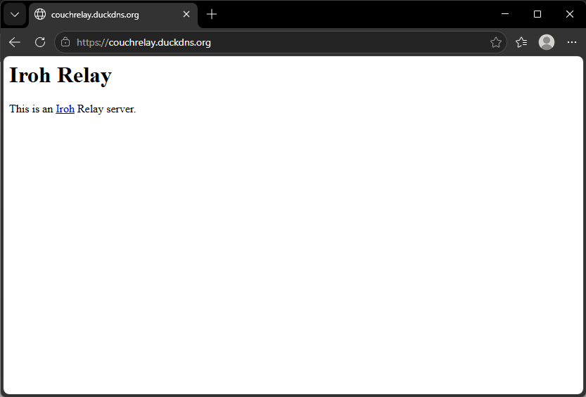
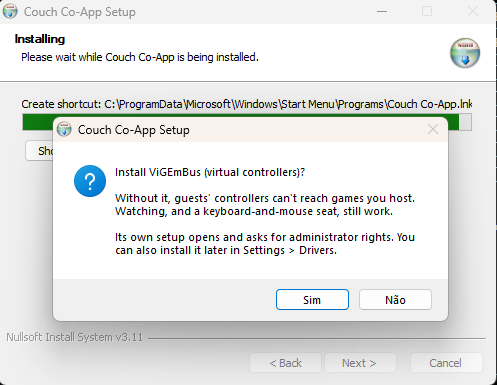
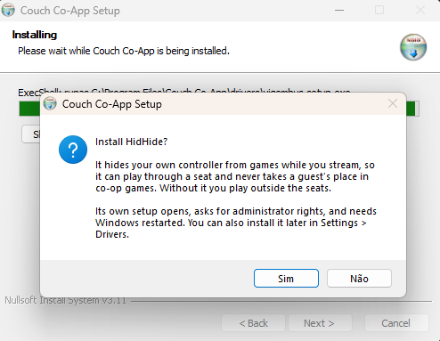
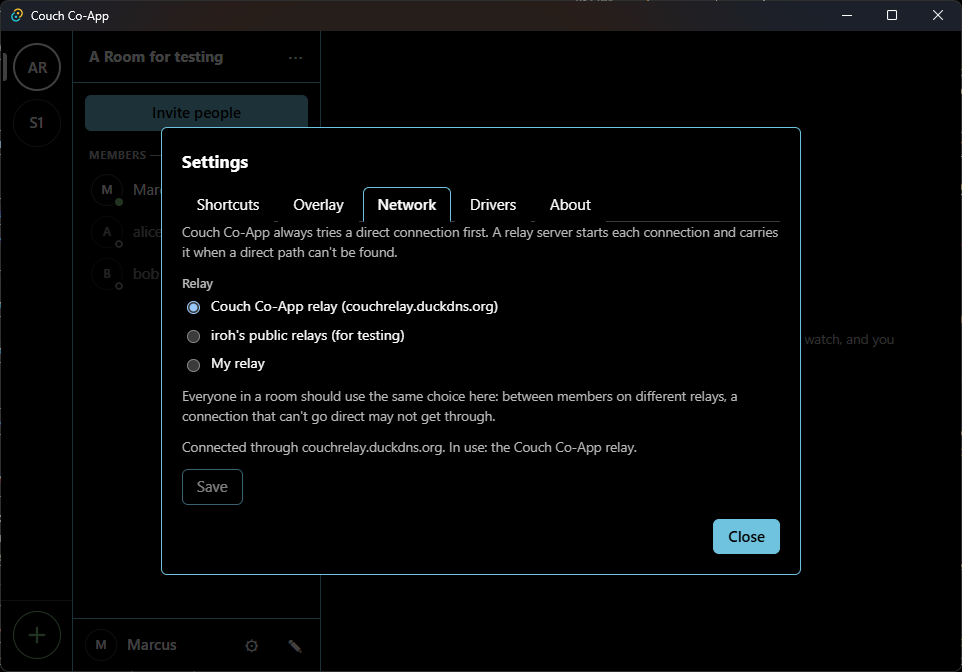
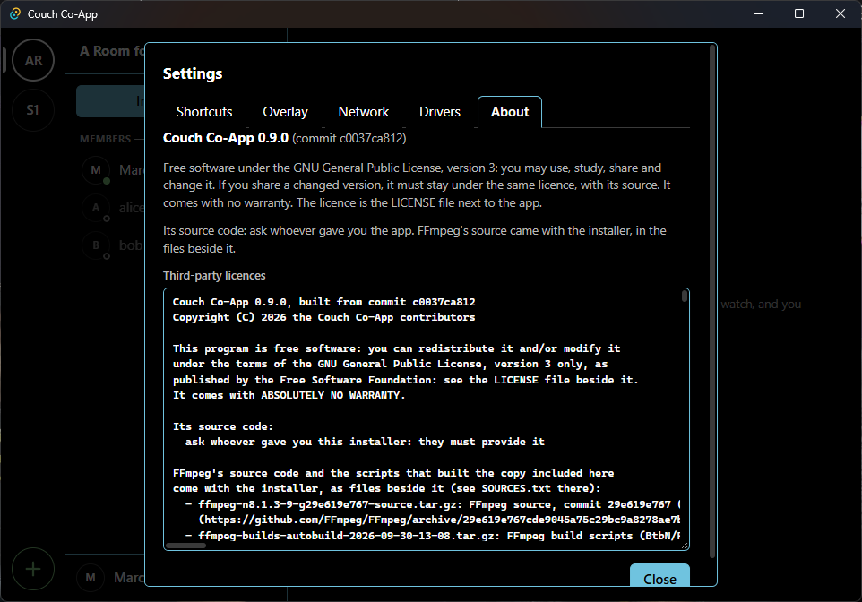

# Use it with your friends: your installer and your own relay

There are no official downloads ([ADR 0009](adr/0009-source-only-releases.md)). To play with your friends, you build the installer yourself, and run a small relay server that helps your friends' PCs find each other. This is the shortest path. It takes an afternoon the first time, mostly waiting for builds, and needs a Windows PC and a small Linux server.

## What you'll end up with

- **An installer** (`Couch-Co-App_<version>_<commit>-setup.exe`) that your friends run. It's unsigned, so Windows SmartScreen warns once: "More info", then "Run anyway".
- **A relay** on a server you control, which only your installers can use. The app connects your friends' PCs directly when it can, and through your relay when it can't.

## 1. Prepare your Windows PC (once)

1. **Install:**
   - Git;
   - Visual Studio Build Tools, with the **Desktop development with C++** workload;
   - Rust (`winget install --id Rustlang.Rustup -e`);
   - Node.js;
   - CMake (`winget install Kitware.CMake`).
2. **Two cargo tools,** in a new terminal:
   ```powershell
   cargo install cargo-deny --locked
   cargo install --locked cargo-about --features cli
   ```
3. **Get the code,** to a short path:
   ```powershell
   git clone <this repository's address> C:\dev\couch-coapp
   cd C:\dev\couch-coapp
   ```
4. **Fetch the dependencies.** In PowerShell, from that folder (run the first line in every new terminal):
   ```powershell
   . .\scripts\dev.ps1
   cargo xtask fetch-deps
   cargo xtask stage-dlls
   cd apps\desktop; npm install; cd ..\..
   ```
5. **Create your private settings and token:**
   ```powershell
   cargo xtask release-config
   ```
   It writes `%USERPROFILE%\.couch-coapp\release.toml` and prints a token. Keep the token in a password manager: the server needs it in step 2. The file is outside the code folder on purpose, so it never ends up in git.

## Do you need your own relay?

**iroh, the networking library the app uses, runs free public relays.** The app can use them, and needs no server of yours.

We still recommend your own, for regular play:
- **iroh offers its public relays for testing and hobby use,** with limits it doesn't publish and no promise they stay up;
- **with your own,** only your installers can use it, and it keeps working as long as you keep it running.

**To use iroh's public relays instead:**
- **For a whole build:** skip step 2, and build with `.\scripts\build-installer.ps1 -TestRelay` in step 3 (no `relay_url` needed). Those installers use iroh's public relays by default, and their names end in `-test`.
- **For one PC, in any build:** **Settings → Network → "iroh's public relays (for testing)"**, then Restart now. "My relay" in the same place takes any relay's address instead.

**Everyone in a room should use the same choice.** When two PCs can't connect directly, each sends through the other's relay. Your own relay accepts only your installers, so a friend on a different setting may not get through.

## 2. Set up your relay (once)

You need a small Linux server (Ubuntu 24.04) with a name pointing at it. A free one works: [deploy/relay/README.md](../deploy/relay/README.md) walks through Oracle Cloud's free tier and a free DuckDNS name, step by step.

1. **Create the server and its name.** In the provider's firewall, open TCP 80, TCP 443 and UDP 7842.
2. **Copy the relay kit to it and install it.** From your PC, in the code folder:
   ```powershell
   scp -i <your SSH key> -r deploy/relay <user>@<your relay's name>:
   ```
   Then, on the server:
   ```bash
   cd relay && chmod +x install.sh
   sudo ./install.sh <your relay's name> <an email for Let's Encrypt>
   ```
   Paste your token when it asks. The first build can take a while on a small server.
3. **Check it:** open `https://<your relay's name>/` in a browser. You should see iroh-relay's page, with no certificate warning:

   

## 3. Build the installer (each time you hand one out)

1. **Point the build at your relay:** in `%USERPROFILE%\.couch-coapp\release.toml`, set
   ```toml
   relay_url = "https://<your relay's name>"
   ```
2. **Build**, in a terminal where you ran `. .\scripts\dev.ps1`:
   ```powershell
   .\scripts\build-installer.ps1
   ```
   It takes several minutes the first time. It needs the code exactly as committed: if you changed anything, commit it first (see [If you change the code](#if-you-change-the-code)).
3. **Hand out everything in `target\installer\`:**
   - the setup file;
   - FFmpeg's two source archives;
   - `SOURCES.txt`.

   The licences require that whoever gets the app can also get its source and FFmpeg's. To serve the folder on your network: `npx --yes http-server target\installer -p 8000`.

**What your friends will see when installing:** after the app installs, it offers the two drivers, one question each, with the buttons in Windows' own language:
- **ViGEmBus:** say yes if they'll host games, so guests' controllers reach the game;
- **HidHide:** optional. It lets the host's own controller play through a seat.

Each one opens its own setup, and Windows asks for administrator rights.

| ViGEmBus | HidHide |
|---|---|
|  |  |

## How to know it worked

- **Settings → Network** shows "Couch Co-App relay (<your relay's name>)", and "Connected through" it.
- **Settings → About** shows the version and the commit it was built from.

| Settings → Network | Settings → About |
|---|---|
|  |  |
- **Your friends can join your room** from an invite link and the password, from their own networks.

Everyone in a room needs an installer from the same build of yours. A different build shows "Needs update" in the member list. Other people's builds can't use your relay, because they don't have your token.

## What you can skip

- **The drivers on your build PC.** The installer offers them to whoever installs it.
- **The invite page,** an optional page that makes invite links clickable in chat apps. To use it, either:
  - **use ours:** set `invite_page = "https://marcusvilete.github.io/couch-coapp/j/"` in `release.toml`. Whoever runs the page could see the invites opened with it (the password still guards the room);
  - **host your own:** your fork's GitHub Pages runs the same workflow ([deploy/invite-page/README.md](../deploy/invite-page/README.md)).

  `build-installer.ps1 -InvitePage <address>` sets it for one build, and `-NoInvitePage` builds with plain `couchco://` links.
- **Tests and the developer tools in [development.md](development.md).**
- **A version bump,** unless you hand out a new installer to people who have an older one. Then bump it in `Cargo.toml`, `apps/desktop/src-tauri/tauri.conf.json` and `apps/desktop/package.json`, all the same.

## If you change the code

The installer's notices tell your friends where its source is: the `repository` address in `Cargo.toml`, at the exact commit it was built from. If you change the code:
1. fork the repository on GitHub;
2. set `repository` in `Cargo.toml` to your fork's address;
3. commit and push;
4. then build.

Otherwise your friends would be pointed at code that isn't what they're running. The build script refuses uncommitted changes, and warns when the commit isn't pushed yet.

## When something goes wrong

- **"Not connected to a relay yet" in Settings → Network:** check `https://<your relay's name>/` in a browser. If it doesn't load, see the relay guide's "Running it" section; a stopped VM is the usual cause.
- **The build stops with an error:** run `cargo xtask doctor`. It checks every tool and dependency.
- **More detail:** [deploy/relay/README.md](../deploy/relay/README.md) for the server, [development.md](development.md) for the build.
