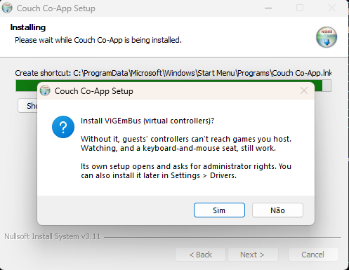
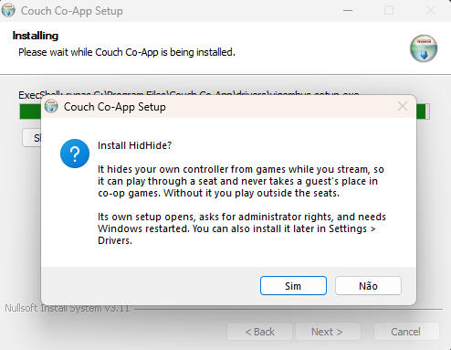
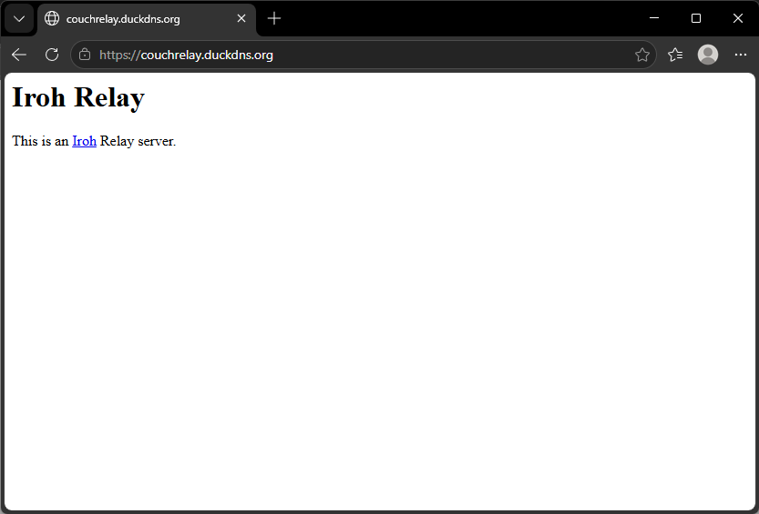
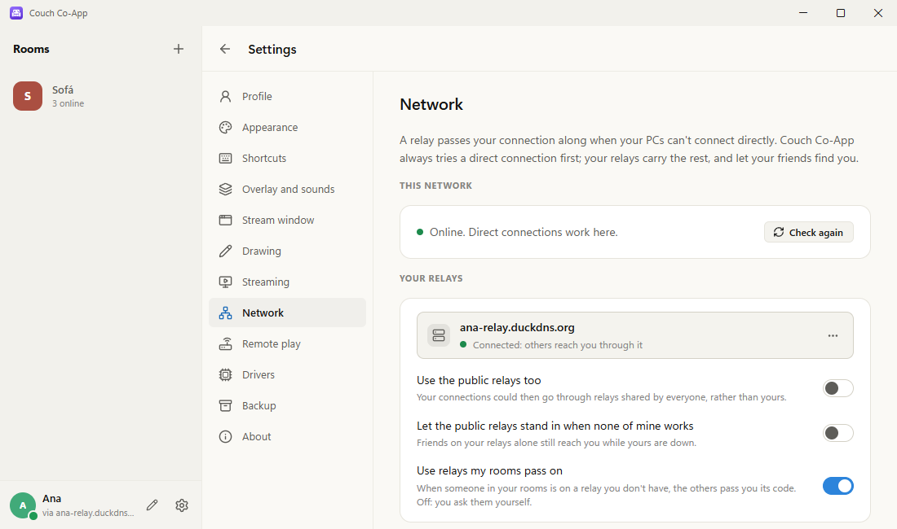
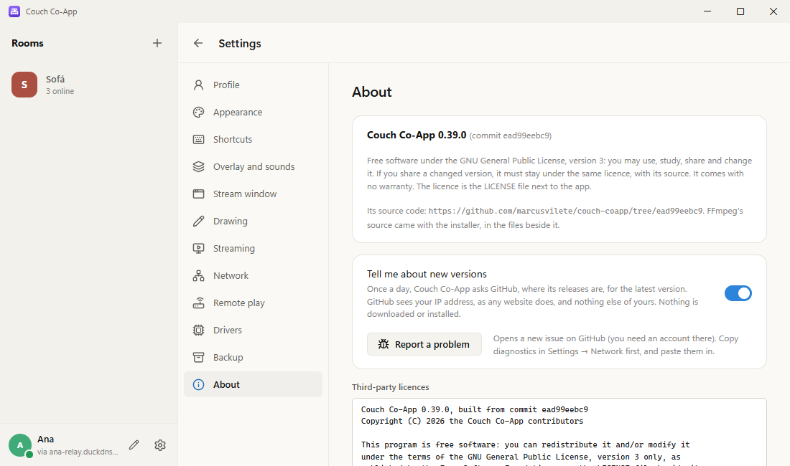

# Play with your friends: the app, and a relay of your own

Install the app from the [releases](https://github.com/marcusvilete/couch-coapp/releases/latest), make a room and send your friends its link. That works as it is, on iroh's free public relays. For regular play, run a small relay of your own: add it in your app, and your rooms get it.

## 1. Install the app

Each [release](https://github.com/marcusvilete/couch-coapp/releases/latest) has a package for each system. Everyone you play with needs the app; the invite page your links open offers the right one.

**Windows 10 and 11:** `Couch-Co-App_<version>_x64-setup.exe`.
- **It's unsigned,** so Windows SmartScreen warns once: "More info", then "Run anyway".
- **It asks whether to install for you or for everyone,** then offers the two drivers it uses, one question each, with the buttons in Windows' own language:
  - **ViGEmBus:** say yes if you'll host games, so guests' controllers reach the game;
  - **HidHide:** optional. It lets the host's own controllers play through seats, one seat each.

  Each opens its own setup, and Windows asks for administrator rights. A driver already installed isn't offered again, and Settings → Drivers installs either later.

  | ViGEmBus | HidHide |
  |---|---|
  |  |  |
- **The first session you host** can take a while to get its controllers ready: Windows sets up each virtual controller the first time it's plugged in. The app says so, with a timer and a Stop waiting button; the controllers come up by themselves, and later sessions start at once.

**Linux:** `Couch-Co-App_<version>_amd64.AppImage`, for a system whose glibc is 2.39 or newer (`ldd --version` says): Ubuntu 24.04 and Fedora 40 are.
- **Make it executable,** then open it: in the file manager, Properties → "Executable as program" (or `chmod +x Couch-Co-App_*.AppImage`). It needs FUSE, which desktops normally have; without it, start it with `--appimage-extract-and-run`.
- **What it does:** it watches and plays sessions, and runs a PC of yours from afar (remote play). On KDE or GNOME, in a Wayland session (the default on both), it also **hosts**:
  - guests' controllers need Settings → Drivers → Virtual controllers set up once, and the desktop asks which window or screen to share;
  - guests can have keyboard and mouse too, on KDE as it is (Plasma 6; Plasma 5.27, Kubuntu 24.04's, hasn't been tried), and on GNOME 46 or later once Settings → Drivers has installed our small extension (then log out and back in once). When a stream starts, the app asks you which window is the game (it offers the likely one); a guest's keys reach that window only while it's in front, and their pointer stays inside it;
  - it can be the PC you run from afar (Settings → Remote play): share a screen at it once and let the desktop remember the choice, since nobody is there to answer the dialog later. Your device can then control its desktop too, once Virtual controllers is set up there.
- **On an X11 desktop** (Linux Mint, Xfce, MATE, a Steam Deck's Desktop Mode), from 0.40.0, it hosts too, with guests' controllers (Virtual controllers set up once): the app lists your windows and screens itself, with no dialog, as on Windows, and it can be the PC you run from afar, your device controlling its desktop. Guests can have keyboard and mouse too, with nothing to install: their keys reach the window you stream only while it's in front and no other program (a menu, a launcher, the lock screen) holds the keyboard, and their pointer stays inside it. The host's keys work on any X11 desktop, through the desktop where it offers them (KDE), else straight from the X server.
- **It uses the system's own PipeWire library** (`libpipewire-0.3`, which current desktops all have), even only to watch.
- **On a Steam Deck:** in Desktop Mode, download it, make it executable and open it; for Game Mode, add it to Steam as a non-Steam game. It watches and plays there. Desktop Mode runs X11, where versions before 0.40.0 can't host; 0.40.0 hosts there as on any X11 desktop (above), not yet tried on a Deck.
- **Invite links** open it once it has started once. Moved to another folder, it needs one start there.
- **It adds itself to the app menu** when it starts (`~/.local/share/applications/com.couchcoapp.CouchCoApp.desktop`, and its icon in `~/.local/share/icons`): the desktop's shortcuts for the panic key need it. A newer AppImage takes the entry over once the old file is gone; deleting both files removes it.
- **Its data and log** are in `~/.local/share/CouchCoApp/profiles/default/` (`desktop.log`).

**macOS** isn't there yet.

**Checking a download** against the release's `SHA256SUMS`: on Windows, `Get-FileHash .\Couch-Co-App_<version>_x64-setup.exe` in PowerShell; on Linux, `sha256sum --check --ignore-missing SHA256SUMS` in the download's folder.

**New versions:** the app says when one is out, in the strip at the bottom of its window, at most once a day (it asks GitHub, which sees your PC's address; Settings → About turns it off). Nothing installs by itself: download the new package and install it over the old one (on Linux, the new AppImage takes the old one's place: delete the old file). When a version changes how members talk to each other, everyone in a room needs it to play together: the notice says so, and the member list says who must update.

## 2. Make a room and invite your friends

1. **Create a room** with a password.
2. **Invite:** the room's Invite makes a link. Send it, and the password separately.
3. **Your friends open the link.** Chat apps don't make the app's own links clickable, so the link opens a small page that shows the room's name, opens the app, and offers the download to someone without it. The app asks for the password before joining.

Out of the box, the app uses **iroh's public relays**: free, shared by everyone, run for testing and hobby use, with limits nobody publishes and no promise they stay up. Creating a room or an invite with no relay of your own asks whether to add one: "Remind me later" asks again in a week, "Stay on the public relays" never.

## 3. A relay of your own

Each pair of players' PCs talks directly whenever it can. A relay starts each connection and carries it when no direct path works (some home routers and most phone networks). It only forwards encrypted traffic it can't read: rooms, passwords, video, sound and input stay between the players' PCs.

**Your own relay** keeps working as long as you keep it running, is used only by those who hold its code, and needs a small Linux server: a free one works.

1. **Set it up,** once: [deploy/relay/README.md](../deploy/relay/README.md) walks through it, with Oracle Cloud's free tier and a free DuckDNS name as the worked example. In short:
   - a small Linux server (Ubuntu 24.04 or Debian 12) with a name pointing at it, and TCP 80, TCP 443 and UDP 7842 open in the provider's firewall;
   - a token, its password: `openssl rand -hex 32`. Keep it in a password manager;
   - the relay kit on the server, the repository's `deploy/relay` folder at your app's version (Settings → About): `git clone --depth 1 --branch v<version> https://github.com/marcusvilete/couch-coapp`, then `cd couch-coapp/deploy/relay`;
   - installed with `sudo bash install.sh <name> <email>`, pasting the token when it asks.

   Then `https://<your relay's name>/` shows iroh-relay's page in a browser, with no certificate warning:

   
2. **Make its code,** on the server, in the kit's folder: `bash relay-code.sh https://<your relay's name>/ <token>`. A relay code is the relay's address and token on one line (`couch-relay-1.…`).
3. **Add it in your app:** Settings → Network → Add a relay, and paste the code. The app connects with it before saving, and says so if the relay refuses it.

**Your rooms get it.** A friend reaches you through your relay only with its code, and they get it by themselves:
- **an invite link carries its code** (a switch in the invite dialog leaves it out). The newcomer joins through it, and keeps it once let in;
- **members of a room pass on the codes** its members' relays need, so friends of friends reach you too. When two PCs can't connect directly, either holding the other's relay is enough;
- **Share its code** (in the relay's ⋯ menu in Settings → Network) copies it for someone by hand, kept out of the clipboard's history. Send it privately.

So **whoever joins a room on your relay can use it.** To choose who does, give each friend a **personal code** of their own, which is never passed on and can be taken back from that one person. To change the code for everyone, **rotate** the token, keeping the old one beside the new for a day while the apps pass the new one on. The relay guide has both, and how to watch its load.

A profile holds several relays at once, each with its own code, and they all apply at once, with no restart: you can be on yours and on a friend's. A relay open to everyone, with no token, is added by its address instead of a code. The public relays are used while a profile has none of its own, and can be kept on beside yours, or let stand in when none of yours answers (Settings → Network, off by default).

## How to know it worked

- **Settings → Network** lists your relay as connected, with "others reach you through it" when it's the one your PC is reached at (with the public relays kept on, that may be one of theirs):

  <picture>
    <source media="(prefers-color-scheme: dark)" srcset="images/settings-network-dark.png">
    
  </picture>
- **Settings → About** shows the version and the commit it was built from:

  <picture>
    <source media="(prefers-color-scheme: dark)" srcset="images/settings-about-dark.png">
    
  </picture>
- **Your friends can join your room** from an invite link and the password, from their own networks.

## When something goes wrong

- **A member can't be reached:** the member list says why when the app can tell: their relay isn't answering, or needs a code nobody in the room can pass on ("ask Bia for it", with Paste a code). Otherwise they may simply be away.
- **A join fails:** the join screen says which step did (the relay, the owner not on it, the password, an old link). A link whose owner uses a relay of their own without its code says so before the password: ask them for its code.
- **Your relay is "Not answering"** in Settings → Network: open `https://<your relay's name>/` in a browser. If it doesn't load, see the relay guide's "Running it"; a stopped VM is the usual cause.
- **"Needs update"** in the member list: you and that member are on versions that can't talk to each other; it says which of you must update.
- **Anything else:** Settings → About → Report a problem opens an issue on GitHub. Settings → Network → Copy diagnostics copies what helps for you to paste into it: versions, relays by their server's name and state, and each room's members' links, numbered; never a name, an IP address, a code, a password or an invite.

## A build carrying your relay

Before public releases, friends got installers built by whoever ran the relay, with the relay inside. That still works: such a build lists its relay as "this app's", it can't be removed, and nobody pastes a code. It needs a Windows PC that builds the app, and a new installer from you for each version. [development.md](development.md#building-installers) has the steps.
